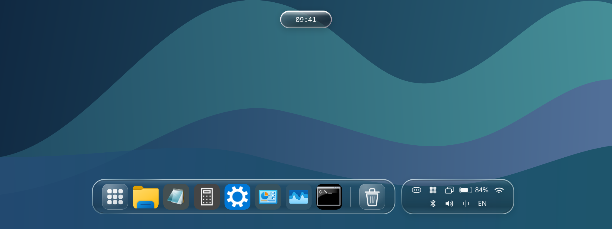
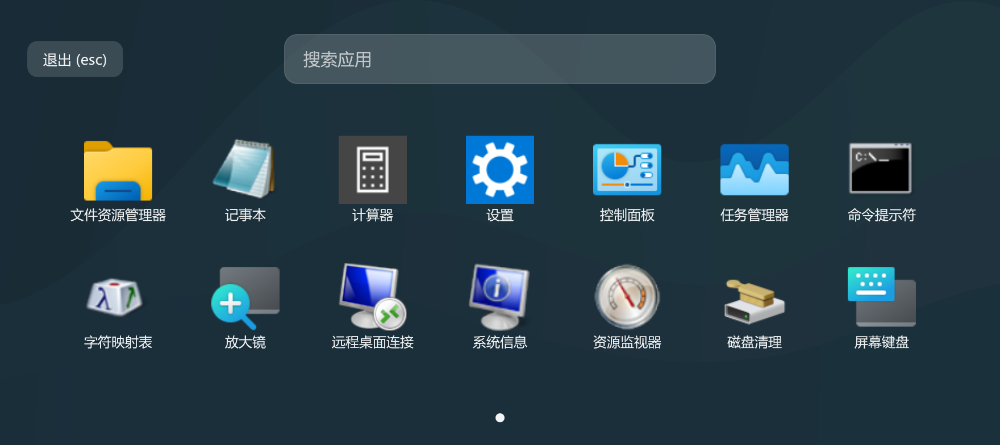

# DockSprig

> **原名 AquaDesk。** 既有 GitHub Release 和安装包仍使用旧名，发布与构建记录保留在本仓库。

> 把 macOS 的桌面质感搬到 Windows：Dock、顶部菜单栏、液态玻璃、圆角、启动台。
> 不动系统底层，只换你看到的那一层。

**当前源码版本：0.6.2** · 两种形态任选：单文件便携版 / 安装版 · 目标机器不用装 .NET


[](LICENSE)

---

## 效果图

图中使用 DockSprig 的界面组件离屏渲染，只展示 Windows 自带应用和 DockSprig 控件。壁纸、时间、电量和系统状态均为演示内容。

### Dock、时间胶囊与状态胶囊



### 启动台



## 0.6.2 · 透明玻璃界面

- Dock 和状态胶囊保留透出壁纸的玻璃底板，用细亮边模拟玻璃厚度，底板透明度仍可调。
- 前台应用以水蓝短线标记，音量、网络、电源和输入法各用固定位置。
- 启动台按可用空间调整行列和分页，应用名称支持两行，键盘焦点有描边。
- 设置页保留 Windows 原生标题栏与左侧分类。「外观」页可以即时预览玻璃透明度与圆角。
- 后台进程扫描移出 UI 线程。关闭窗口预览后停止枚举，暂停时不再强制 GC 或裁剪工作集。

## 它是什么

Windows 的原生桌面已经很好用，但视觉语言停在另一个时代。DockSprig 不做换壁纸那种表面功夫，
而是把「你看到的那一层」整个换掉：

- 底部 **Dock**：磁贴化图标、悬停放大 + 邻居让位、运行指示条、窗口预览、文件夹、拖拽排序
- 顶部 **时间胶囊**：时钟；检测到在放歌时自动拉宽成播放条（播放器图标、曲名歌手、上一首 / 暂停 / 下一首）
- 右侧 **状态胶囊**：设置、电源、后台程序、电量、WiFi、蓝牙、音量、输入法，固定两排位置
- **后台程序面板**：列出所有窗口程序和托盘程序（含当前前台），点一行就切过去（替代系统托盘）
- **窗口层级三档**：最大化时让开 / 始终最上层（不含全屏应用）/ 始终最下层
- **液态玻璃**：半透明底板与静态亮边，可正常截图与录屏
- **启动台**：全屏网格、搜索、分页、文件夹、拖入
- **系统集成**：开机自启、隐藏原生任务栏、隐藏桌面图标
- **设置页**：五类分栏；选项实时生效，改完按「保存」落盘（关窗兜底存一次）

资源管理器、程序、驱动全都照旧，只是外壳变成了 mac 的样子。

## 功能一览

- **Dock 底座**：磁贴图标、悬停放大 + 邻居让位、运行指示条、拖拽排序、文件夹分组、四边停靠（上 / 下 / 左 / 右）、自动沉浮策略
- **顶部时间胶囊**：时钟；播放音乐时自动拉宽成播放条（SMTC 媒体控制：上一首 / 暂停 / 下一首）
- **右侧状态胶囊**：设置、电源、后台程序、电量、WiFi、蓝牙、音量、输入法，固定两排位置
- **后台程序面板**：列出窗口与托盘程序，一键切前台或结束后台
- **窗口预览**：悬停缩略图（PrintWindow 静态抓图）
- **液态玻璃**：透明底板、圆角和双层细边，可正常截图与录屏
- **启动台**：全屏网格、搜索、分页、文件夹、拖入
- **系统集成**：开机自启、隐藏原生任务栏、隐藏桌面图标、窗口层级三档
- **设置页**：五类分栏，改动实时预览、保存落盘
- **检查更新**：GitHub Releases + 国内镜像兜底，启动静默检查，可跳过版本
- **安装版（Velopack）**：应用内一键升级、打开安装目录、卸载；发布包带代码签名与 SHA256 校验

## 版本索引

按功能阶段整理主要版本。

| 版本 | 日期 | 主题 |
| --- | --- | --- |
| [v0.1.0](versions/v0.1.0/README.md) | 2026-10-20 | Dock 基础：图标、悬停放大、拖放排序、单文件发布 |
| [v0.2.0](versions/v0.2.0/README.md) | 2026-10-21 | 玻璃与启动台：液态玻璃、启动台、文件夹、WiFi/蓝牙/音量面板 |
| [v0.3.0](versions/v0.3.0/README.md) | 2026-10-26 | 窗口预览与停靠：窗口缩略图、系统图标、四边停靠、界面缩放 |
| [v0.4.0](versions/v0.4.0/README.md) | 2026-10-31 | 灵动岛与外观：顶栏改时间胶囊、右侧状态胶囊、外观切换、设置页重做 |
| [v0.5.0](versions/v0.5.0/README.md) | 2026-11-01 | 系统区成型：灵动岛播放形态、状态胶囊网格、后台程序面板、浮层让位 |
| [v0.6.0](versions/v0.6.0/README.md) | 2026-11-02 | 安装与更新：检查更新、安装版、代码签名 |
| [v0.6.1](versions/v0.6.1/README.md) | 2026-11-02 | 外观修正：默认外观透明度可调、可完全透明、距屏幕边缘上限提升、修复拖动抖动与自启重启 |
| v0.6.2 | 2026-11-22 | 透明玻璃界面更新与常驻性能优化 |

完整变更历史见 [CHANGELOG.md](CHANGELOG.md)。

## 快速开始

### 下载运行

下载前可查看 [Code signing policy](#code-signing-policy) 和 [Privacy policy](#privacy-policy)。

到 [Releases](https://github.com/ShiraiYuzen/DockSprig/releases) 页面下载，两种形态二选一：

| 产物 | 适合谁 | 说明 |
| --- | --- | --- |
| `AquaDesk-<版本>.exe` | 绿色软件党 / 极客 | 单文件自包含，放哪都能跑，不装 .NET；升级时提示内容 + 一键打开发布页手动下载 |
| `AquaDesk-win-Setup.exe` | 普通用户 | 双击后选安装目录，装完自动更新 |

想要「装好就能自动更新」的选安装版；想要「一个 exe 走天下、手动掌控更新」的选便携版。

> 安装版从 **0.6.0 这一版才开始提供**，更早的版本只有单文件便携版。
> Windows 可能弹出 SmartScreen「未知发布者」警告，那是因为安装包用的是自签名证书，
> **属于正常现象，文件没有问题**，照常放行即可。

### 升级

重复启动 = **新版本接管**：双击任意一个 exe，正在跑的旧版本会自动退出、新版本接手。
所以升级时不用先去托盘里找「退出」。

## 构建

### 环境要求
- Windows 10 / 11
- [.NET 8 SDK](https://dotnet.microsoft.com/download/dotnet/8.0)

### 从源码构建
```bash
git clone https://github.com/ShiraiYuzen/DockSprig.git
cd DockSprig/src/AquaDesk.App
dotnet build -c Release
```
构建产物在 `bin/Release/net8.0-windows10.0.19041.0/win-x64/`。

### 一键出发布包
仓库根目录的 `build.ps1` 可构建便携版并生成 SHA256 校验文件。本机配置了签名证书时会尝试签名。
```powershell
.\build.ps1
```

## Code signing policy

DockSprig plans to use SignPath.io for Windows code signing with a certificate from SignPath Foundation, subject to approval and setup. The intended signing process uses artifacts built from this public repository by [GitHub Actions](https://github.com/ShiraiYuzen/DockSprig/actions). Each release signing request will require manual approval.

- Maintainer, committer, and reviewer for this repository: [ShiraiYuzen](https://github.com/ShiraiYuzen).
- Designated release signing approver: [ShiraiYuzen](https://github.com/ShiraiYuzen).

### Privacy policy

DockSprig does not send telemetry or automatically upload crash reports. Settings and diagnostic logs are stored locally. The Dock and Launchpad use local app information, and window previews are generated on the device. When you enter a Wi-Fi password in DockSprig, it is passed to Windows to configure the selected network.

DockSprig automatically checks for updates using GitHub Releases. If the primary request fails, it may use third-party mirrors. The servers handling update checks and downloads can see the source IP address and standard HTTP request headers, including the app's User-Agent. DockSprig does not attach local settings, window previews, or diagnostic logs to update requests.

See the [GitHub Privacy Statement](https://docs.github.com/en/site-policy/privacy-policies/github-general-privacy-statement) for how GitHub handles network requests. The backup services used by the updater are [ghproxy.net](https://ghproxy.net/), [gh-proxy.com](https://gh-proxy.com/), and, for some downloads in the `net48` build, [ghfast.top](https://ghfast.top/). These services handle their own requests under their own practices.

## 已知限制

- **窗口预览是静态抓图**：用 `PrintWindow` 而非实时缩略图，所以预览不会动。
- **任务栏占用**：隐藏原生任务栏后，鼠标碰到屏幕底边任务栏会弹一下（系统 autohide 的代价）。
- **提权窗口抓不到**：任务管理器这类进程受系统保护，预览退回应用图标、关闭菜单置灰。
- **能正常截图**：玻璃使用静态描边与透色底板，截图和录屏可保留 Dock。
- **内存占用偏高**：自包含 .NET 运行时，工作集约 300+ MB。
- **自签名证书**：能确认「文件来自同一发布者」，但 Windows 默认不信任，SmartScreen 仍会拦。

## 其他分支

- **net48 分支**（实验性）：基于本仓库源码改到 .NET Framework 4.8（系统自带、进程间共享运行时）。内存约 212 MB（本分支 ~300+ MB）、安装包仅 ~0.7 MB，适合想显著降低占用的机器；应用内可检查更新并打开对应的 Release 页面下载 ZIP。详见其 [README](https://github.com/ShiraiYuzen/DockSprig/blob/net48/README.md)。

## 许可证

[MIT License](LICENSE)

Copyright © 2026 ShiraiYuzen。此许可适用于 DockSprig 原创项目源码。第三方依赖适用各自的许可。

## 致谢

界面语言参考 macOS Aqua 设计语言。所有图标均为矢量自绘或取自系统，不含第三方素材。
